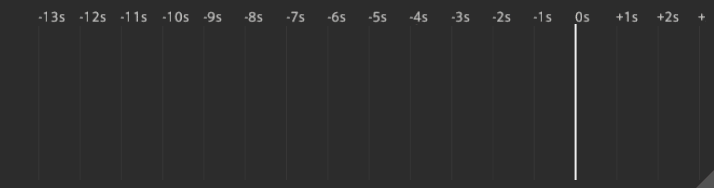
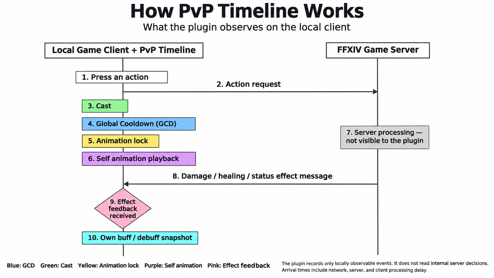

# PvP Timeline

[English](README.md) | **简体中文**

为《最终幻想 XIV》PvP 设计的个人实时技能时间轴。

把「释放技能」「读条」「公共冷却」「动作锁」「自身动画」和「效果反馈」放在同一条时间线上，帮助你回看刚才的操作：技能什么时候交出去了，什么时候收到效果反馈，中间又插入了哪些能力技。



> 当前为测试版本。游戏更新可能影响采集与显示；部分技能的特殊阶段仍可能缺少反馈。时间轴是本机观测工具，不是服务器内部判定的精确还原，也不提供自动施法功能。

## 工作原理



上图把游戏客户端与服务器之间交换的消息，和插件在本机观察到的计时信息区分开来。PvP Timeline 记录已经形成的动作请求、本机可见的读条与冷却状态、动作锁、自身动画播放、收到的效果消息，以及本人当前的状态快照。图中的颜色与时间轴默认显示的含义一致。

插件不会额外发送战斗数据包，也无法查看服务器内部的判定过程。没有形成游戏动作请求的物理按键无法被插件观察到。效果反馈时间表示本机客户端收到消息的时刻，因此其中包含网络传输、服务器处理和客户端处理延迟。

## 它能做什么？

- **上下分层看技能**：下方使用较大的图标显示魔法、战技及部分特殊动作，上方使用较小的图标显示能力技；能力技最多使用两排，避免无限增高。
- **区分不同的时间**：公共冷却、读条、动作锁和动画各有独立轨道，不把它们当作同一个东西。
- **观察效果反馈**：伤害、治疗、状态应用等消息到达后，在对应技能上标出粉色菱形；暴击、直击结果反馈到原技能图标的柔光高亮上。
- **保留延迟触发效果**：可识别的自动爆炸、后续阶段等会关联原释放，或以半透明图标显示实际触发效果，不伪造一次手动按键。
- **查看自身 Buff**：在技能轴下方显示紧凑的状态历史与计时，包含筛选后的增益及已观测到的弱化状态。
- **按习惯调整外观**：支持锁定穿透、横向／纵向、反向滚动、颜色、背景透明度、图标大小及整体缩放。
- **随时冻结回看**：暂停画面观察刚才的技能顺序，或清空当前记录重新测试。

本插件只在已支持的**狼狱停船场、水晶冲突、纷争前线和烈羽争锋**区域启用观测，普通 PvE 区域不启用。新增地图需要更新支持列表。

## 安装与开始使用

### 安装

需要能够运行 **Dalamud（卫月）API 15** 插件的游戏环境。请使用与当前游戏和卫月版本兼容的发布包。

目前使用开发插件方式加载：

1. 安装并启动 XIVLauncher，确认 Dalamud 已启用。

2. 打开 **Dalamud 设置 → 测试版**。

3. 添加下面的自定义插件仓库地址：

   ```text
   https://raw.githubusercontent.com/chefiffer/dalamud-plugins/main/repo.json
   ```

4. 打开插件安装器，搜索 **PVPTimeline ** 并安装。

5. 在游戏聊天栏输入以下命令打开设置：

   ```text
   /pvptimeline
   ```

6. 进入狼狱停船场或受支持的 PvP 地图，使用技能即可观察时间轴。

### 第一次调整

建议先保持「仅战斗中」关闭，在狼狱停船场对木人测试：

1. 在设置的「显示」页解除锁定，拖动时间轴到合适位置，并调整窗口大小。
2. 在「排版」页调整 GCD 和能力技的图标大小、条形位置与粗细。
4. 调好后启用「锁定」，让鼠标穿透时间轴，减少误操作。

锁定后无法直接点击时间轴，请通过 `/pvptimeline` 重新打开设置。解锁时也可以右键时间轴打开设置。

## 怎样看懂时间轴？

### 技能图标与时间

`0s` 表示当前观察时刻；负数表示已经过去的时间。正常运行时，刻度和数字保持固定，技能与时间条向历史方向移动。

大号图标所在的下轨不等于「所有技能都占用公共冷却」：部分极限技或特殊动作也会放在这里。是否存在蓝色公共冷却条，以实际观测到的共享冷却为准。

| 默认显示 | 含义 |
| --- | --- |
| 蓝条 | 实际观测到的公共冷却（GCD） |
| 绿条 | 本机观测到的读条阶段 |
| 明黄色短条 | 动作锁，与公共冷却分别记录 |
| 紫条 | 已观测到的自身动画播放区间 |
| 粉色实心菱形 | 收到伤害、治疗、状态应用等直接效果反馈；部分已核对的位移技能也可表示服务端确认 |
| 粉色空心菱形 | 收到特效、量谱等反馈，不能据此认定造成了伤害或治疗 |
| 半透明技能图标 | 可能是尚未确认的读条，或没有对应手动释放记录的实际触发效果；不等于又按了一次技能 |
| 图标柔光 | 从实际效果消息中读取的暴击、直击或直暴结果；颜色可调整 |
| 灰色细条（默认关闭） | 技能自身的独立冷却，不是公共冷却 |

以上颜色均可修改。同一个技能的多目标结果可能不同，图标高亮会合并本次已观测到的结果，并不表示所有目标都发生了直暴。

自愈和暗影锋还有单独的**自身短冷却蓝条**，显示在能力技轨道。它们仍是独立冷却，不会因此变成 GCD 技能。

### 为什么有时没有紫条或菱形？

紫条只使用自身动画的实际观测。没有采到、无法唯一关联、动画暂停或被其他技能覆盖，都可能使它缺失、出现间断或提前停止。只有确认被另一技能覆盖时，才标记相应的中断符号；普通结束不额外画橙色菱形。

粉色菱形则来自实际效果反馈。没有收到、无法可靠关联，或效果属于尚未支持的特殊阶段时，不会按技能说明猜一个标记。

**没有线或标记，不足以证明技能没有生效。** 插件也不会拿 GCD 或动作锁的长度补成动画时间。

## 怎样看 Buff 行？

Buff 行主要展示**本人实际持有的状态**。来源可以是自己、队友或敌人，但不会仅凭队友释放了某个技能，就推断自己一定获得了对应效果。

增益采用紧凑的起止图标与连接条：

- 状态出现后，起始图标随时间移动；尚未到达左侧边界时，不会提前在边界复制一个图标。
- 起始图标到达边界后进入排队区。已知剩余时间时，在图标下面显示最多两位数字，不带单位、不显示零。
- 排队区按结束时间排列，较早结束的状态靠右，便于先看到即将结束的状态。
- **带红色小杠的图标表示结束节点**。如果已知预计结束时间，它可以提前出现在未来区域；红杠不表示该状态此刻已经结束。
- 状态结束后，结束节点继续向历史方向移动，与起始图标相遇时，这一段显示消失。

不同来源的状态可分别记录；刷新、叠加或移除以本人状态列表的实际变化为准，不按施法次数凭空增加层数。

不是所有状态都会显示。插件会筛选已核对的职业增益，排除部分职能选择标识、技能预备／续键状态等。该筛选仍在完善中，不能将它当作完整的全职业 Buff 数据库。如果您有想要添加显示的 buff 请提交issue或者反馈给开发者。

**插件只显示能确认的状态和倒数。**若你身上的增益没有可读取的剩余时间，就不显示倒数；需要进入战斗等条件才能生效的部分，目前不会单独判断。

## 常用设置

| 位置 | 可以调整什么 |
| --- | --- |
| 设置顶部 | 语言、整体缩放，以及冻结／恢复实时、清空记录 |
| 显示 | 启用、锁定穿透、仅战斗中、过场隐藏、Buff 行、原生动画观测、方向和背景 |
| 排版 | 两类图标大小、能力技高度与排间距、GCD／能力技各自的条形位置和粗细、读条及动画位置 |
| 轨道 | 各类时间条的显示与颜色、自身短冷却、能力技和自动攻击 |
| 时间 | 每秒像素、历史显示范围、未来预留、网格与每秒细分 |
| 高亮 | 暴击／直击柔光颜色、动画覆盖标记颜色、触发效果图标透明度 |

数值可以直接输入，也可以将鼠标停在对应输入框上，用滚轮上调或下调；滚轮调整会结束该输入框当前的文字编辑。整体缩放支持 **0.2–2.0 倍**，时间轴文字也随之缩放。

支持简体中文、繁体中文、英语、德语、法语和日语。首次使用默认跟随卫月界面语言，也可手动选择。技能与状态名称优先使用已有多语言名称资源；新技能或缺失译名可能回退到英文、客户端名称或编号。玩家姓名不会被翻译。如果有语言翻译问题请您提交issue或者反馈给开发者。

需要修订界面翻译时，可编辑 DLL 同目录的 `ui-localization.txt` 后重新加载插件。该文件控制界面文字，技能和状态名称不在这个 TXT 中。

## 常见问题

### 进入游戏后看不到时间轴

先确认当前位于受支持的 PvP 区域，插件已启用，并检查是否开启了「仅战斗中」或「过场隐藏」。仍不显示时，打开设置下方的「诊断」检查观测状态；游戏更新后可能需要等待兼容性修复。

### 连续点击一个技能，为什么没有每次点击的图标？

时间轴展示的是可观测到的释放过程，不是鼠标点击记录器。未产生游戏动作请求的物理点击无法读取；失败连点也不会铺成一串红条或图标。

### 自动触发的伤害为什么是半透明图标？

插件收到了由自己造成的效果，但未必存在对应的手动释放记录。例如自动爆炸会实际造成伤害，却不代表你在那个时间又按了一次按钮。能够可靠关联的阶段会回填原技能，其他实际触发效果可保留为半透明图标。

### 反馈时间能当作技能的服务器判定时间吗？

不能。它是本机收到消息的时刻，包含网络、服务器与客户端处理的影响；动画观测也不等于服务器命中快照。读条结束不等于已经测出了最早可移动的时刻。

### 它会上传数据或保存完整比赛吗？

当前时间轴不自动上传战斗数据，也不持续保存完整比赛日志。它保留有上限的近期内存记录；换地图或清空会重置记录。

诊断信息只有在点击复制按钮后才写入本机剪贴板，可能包含实体 ID、技能／状态 ID 和时间等信息。分享前请自行检查。

## 限制与使用提醒

- 每次释放的反馈关联窗口最长为 **14 秒**。超过截止时间的反馈不会无限占用待确认位置；缺少来源序列或存在多个候选时，也不会强行配对。
- 动作历史最多保留 256 条、最长 120 秒；界面可显示的历史范围另有设置。当前状态与历史状态也有数量上限，避免无限增长。
- 当前动画观测主要针对自身，不包含完整的目标侧动画、弹道或地面特效还原。
- 原生动画观测涉及游戏内部接口。游戏更新可能导致失效或稳定性问题；可在设置中关闭该观测，但不应将此理解为卸载了插件所有观测接口。
- 这是非官方第三方插件。请自行了解游戏及插件平台的使用规则；本项目不作账号安全或零崩溃保证。

## 反馈问题

提交问题时，建议提供：

1. 插件版本、游戏区域／版本、使用语言。
2. 职业、技能名称，以及手动触发还是自动触发。
3. 期望显示什么、实际显示什么，以及可复现的操作顺序。
4. 截图或短 GIF；关联错误时可附设置中复制的效果诊断，加载异常时可附脱敏后的卫月日志。

截图能说明显示问题，诊断数据能帮助区分「没有采到」和「采到了但关联或绘制有误」。请勿上传账号令牌、密码或无关的私人日志。

## 致谢

本项目在时间轴表现、锁定交互和自定义设置方面参考了以下项目：

- [ActionTimelineEx](https://github.com/Ted-Jin-Lab/ActionTimelineEx)
- [ActionTimelineReplacement](https://github.com/Loskh/ActionTimelineReplacement)

PvP Timeline 不是上述项目的官方版本。游戏图标及相关素材的权利归各自权利人所有。

## 许可证

PvP Timeline 采用 GNU Affero General Public License v3.0。完整条款请参阅 [LICENSE](LICENSE)；上游 fork 保留的 MIT 声明请参阅 [THIRD-PARTY-NOTICES.txt](THIRD-PARTY-NOTICES.txt)。
